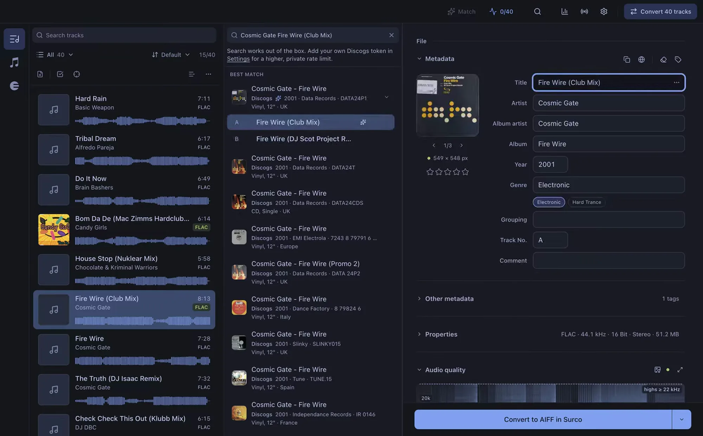

<p align="center">
  
</p>

<h1 align="center">Surco</h1>

<p align="center">
  Open-source track organizer for DJs, for macOS and Windows.
</p>

<p align="center">
  <a href="https://github.com/surco-app/surco-releases/releases/latest"></a>
  <a href="https://github.com/surco-app/surco-releases/releases"></a>
  <a href="LICENSE"></a>
</p>

Drop your tracks in. Surco finds the right metadata, checks that your files really are lossless, converts them and marks their cues. Then it keeps your rekordbox, Traktor, Engine DJ and Apple Music libraries up to date, so a track stays the same track everywhere you play it.

<p align="center">
  
</p>

## What it does

- **Auto-tagging.** Searches Discogs, Bandcamp, Deezer, Beatport and MusicBrainz and matches whole imports on its own. Title, duration, artist and catalog number have to agree before anything is written, and uncertain matches wait for a one-click review instead of being applied.
- **Fake-lossless detection.** A spectrogram and a verdict that explains itself with the numbers it measured. It flags a 320 kbps re-encode sold as FLAC or WAV, upsampled audio and other quality lies.
- **Cue editor.** Hot cues and CALLs on the rekordbox wave and grid. Pick a flow such as Mix in 64 or one of your own, click where the track drops and the rest of the cues land counting back.
- **Auto mark.** Suggests where each track drops, on one track or a whole selection, and tells sure suggestions from doubtful ones. It learns how you mark from the cues you already placed and the ones you save.
- **Your libraries, inside Surco.** Opens your rekordbox, Traktor, Engine DJ and Apple Music playlists with their folders and order. rekordbox and Traktor playlists can be created, renamed, reordered and filled from Surco, and the cues you save reach the same track in rekordbox, Traktor and Engine DJ.
- **Conversion that keeps the track.** AIFF, MP3 (320/V0), WAV, FLAC and ALAC, with optional loudness or peak normalization. Convert a track your DJ software already knows and it keeps its playlists and cues there.
- **USB sticks for your players.** Writes a stick for Pioneer DJ and AlphaTheta players, or one with an Engine DJ library.
- **BPM and key.** Detected on your machine, shown in Camelot or classic notation.
- **Built for batches.** Duplicate detection, metadata review for Apple Music, watched folders, multi-track editing, undo, backups of everything it replaces and keyboard-first navigation.

Everything runs on your machine. No account, no subscription, no telemetry. The app speaks English, Spanish, German, French, Portuguese and Japanese.

## Install

**[Download from getsurco.app](https://getsurco.app/en)**. Notarized macOS builds for Apple Silicon and Intel and a Windows installer, with automatic updates.

macOS via Homebrew:

```bash
brew install --cask surco-app/surco/surco
```

All builds are published at [surco-app/surco-releases](https://github.com/surco-app/surco-releases/releases).

## Learn more

- [Guide](https://getsurco.app/en/guide), every feature with screenshots.
- [Changelog](https://getsurco.app/en/changelog), what shipped in each release.
- The site in [Spanish](https://getsurco.app/), [German](https://getsurco.app/de), [French](https://getsurco.app/fr), [Portuguese](https://getsurco.app/pt) and [Japanese](https://getsurco.app/ja). This README in [Japanese](README_ja.md).

## Develop

Monorepo with npm workspaces: `apps/desktop` (Electron, React and TypeScript) and `apps/web` (Vite, React and Tailwind).

```bash
npm install            # install all workspaces

npm run dev:desktop    # Electron app in development
npm run dev:web        # website in development
npm test               # desktop and website test suites
npm run build:desktop  # production build
npm run build:web      # website build
npm run dist:desktop   # package the installer
```

## Contributing

Issues and pull requests are welcome. Surco is GPL-3.0, so improvements stay open for everyone.

## Third-party software

Surco bundles [baken](https://github.com/M-Igashi/baken) by Masanari Higashi (MIT licence) to write USB sticks for Pioneer DJ / AlphaTheta players, built from its v4.6.1 source with the patches in `apps/desktop/vendor/baken/patches`. Its licence and those of its dependencies ship next to the binary (`Contents/Resources/baken/` on macOS, `resources\baken\` on Windows).

## License

Copyright (C) 2026 Vicent Gozalbes.

Surco is free software under the [GPL-3.0-or-later](LICENSE). You can redistribute it and modify it, but any derivative work must be published under the same license, with its source code and this copyright notice.
