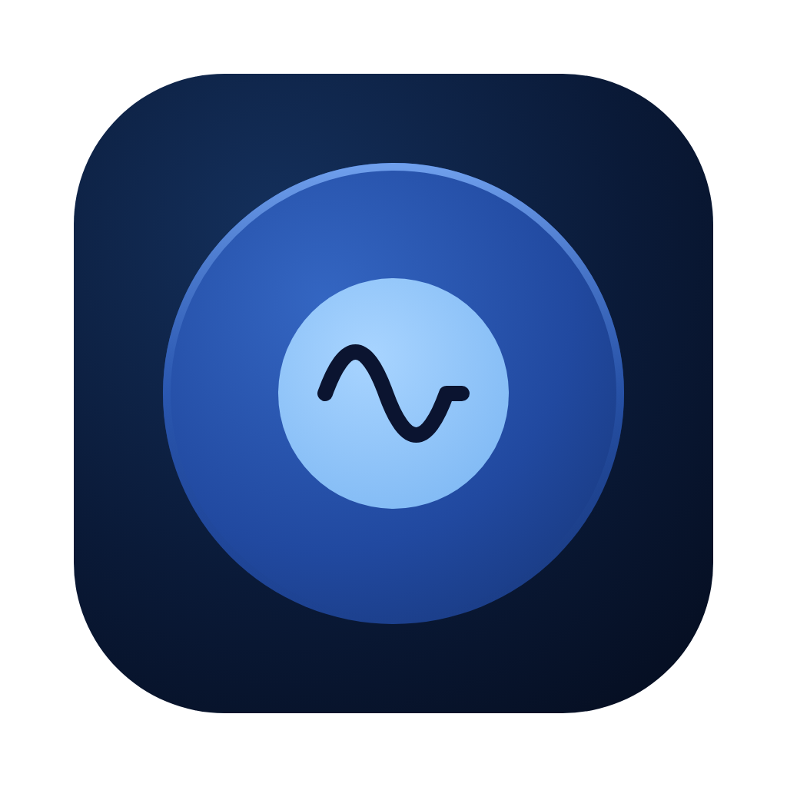
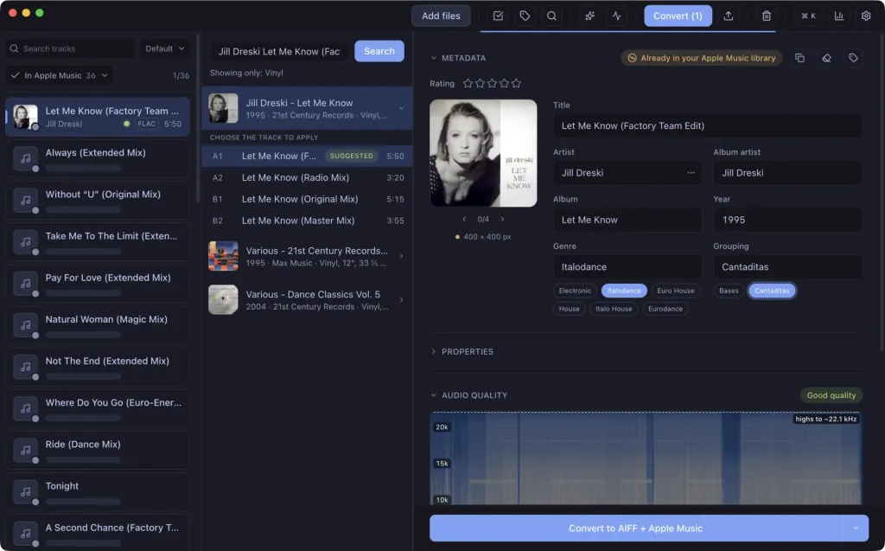

<p align="center">
  
</p>

<h1 align="center">Surco</h1>

<p align="center">
  DJ のための無料・オープンソースの楽曲管理ツール — macOS &amp; Windows 対応。
</p>

<p align="center">
  <a href="https://github.com/surco-app/surco-releases/releases/latest"></a>
  <a href="https://github.com/surco-app/surco-releases/releases"></a>
  <a href="LICENSE"></a>
</p>

トラックをドロップするだけ。Surco が Discogs、Bandcamp、Deezer、Beatport、MusicBrainz から適切なメタデータを探し、ファイルが本当にロスレスかを確認。BPM とキーの検出、ファイル形式の変換を行い、DJ ソフトウェアや Apple Music に引き渡します。

<p align="center">
  
</p>

## 機能

- **自動タグ付け** — Discogs、Bandcamp、Deezer、Beatport、MusicBrainz を検索し、取り込んだトラック全体を自動で照合します。タイトル、再生時間、アーティスト、カタログ番号の一致を確認してから書き込みます。不確かな候補は自動適用せず、ワンクリックで確認できるようにマークします。
- **偽ロスレス検出** — スペクトログラムと自動判定で、320 kbps の音源を再エンコードして FLAC/WAV として販売しているものや、アップサンプリングされた音声などの品質偽装を検出します。スペクトルを目を凝らして確認する必要はもうありません。
- **BPM とキー** — ローカルで検出し、Camelot 表記または一般的な調名表記で表示します。
- **変換** — AIFF、MP3（320/V0）、WAV、FLAC、ALAC に対応。オプションでラウドネス正規化（インテグレーテッド LUFS の目標値 + トゥルーピークリミッター）またはピーク正規化を適用できます。
- **DJ 環境との連携** — rekordbox、Traktor、Serato、Engine DJ へのエクスポート、Apple Music への直接追加、M3U8 プレイリストに対応しています。
- **一括処理に対応** — 重複検出、フォルダー監視、複数トラックの編集、元に戻す操作、キーボード中心の操作を備えています。

すべての処理はお使いのマシン上で実行されます。アカウント不要、テレメトリーなし。

## インストール

**[getsurco.app からダウンロード](https://www.getsurco.app/en)** — Apple の公証済み macOS ビルド（Apple Silicon &amp; Intel）と Windows インストーラーを提供しています。自動更新にも対応。

macOS では Homebrew からもインストールできます。

```bash
brew install --cask surco-app/surco/surco
```

すべてのビルドは [surco-app/surco-releases](https://github.com/surco-app/surco-releases/releases) で公開されています。

## 詳細情報

- [ガイド](https://www.getsurco.app/en/guide) — すべての機能をスクリーンショット付きで紹介。
- [変更履歴](https://www.getsurco.app/en/changelog) — 各リリースの変更内容。
- スペイン語版もあります：[getsurco.app](https://www.getsurco.app/)。

## 開発

npm workspaces を使用したモノレポです。`apps/desktop`（Electron + React + TypeScript）と `apps/web`（Vite + React + Tailwind）で構成されています。

```bash
npm install            # すべてのワークスペースの依存関係をインストール

npm run dev:desktop    # Electron アプリを開発モードで起動
npm run dev:web        # ウェブサイトを開発モードで起動
npm test               # デスクトップのテストスイートを実行
npm run build:desktop  # 本番ビルド
npm run build:web      # ウェブサイトをビルド
npm run dist:desktop   # インストーラーをパッケージ化
```

## コントリビュート

Issue やプルリクエストを歓迎します。Surco は GPL-3.0 のもとで提供されているため、改善もすべての人に公開されます。

## ライセンス

Copyright (C) 2026 Vicent Gozalbes.

Surco は [GPL-3.0-or-later](LICENSE) のもとで提供されるフリーソフトウェアです。再配布・改変は可能ですが、派生物はソースコードとこの著作権表示を含め、同じライセンスで公開する必要があります。
