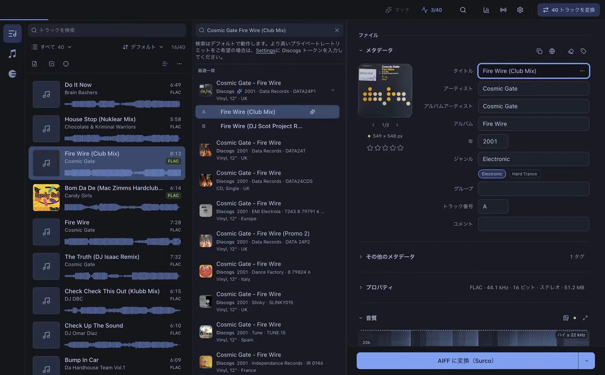

<p align="center">
  
</p>

<h1 align="center">Surco</h1>

<p align="center">
  DJ のためのオープンソースのトラック整理アプリ。macOS と Windows に対応。
</p>

<p align="center">
  <a href="https://github.com/surco-app/surco-releases/releases/latest"></a>
  <a href="https://github.com/surco-app/surco-releases/releases"></a>
  <a href="LICENSE"></a>
</p>

トラックをドロップするだけ。Surco が適切なメタデータを探し、ファイルが本当にロスレスかを確認し、変換してキューを付けます。そのうえで rekordbox、Traktor、Engine DJ、Apple Music のライブラリを最新の状態に保つので、どのソフトで再生しても同じトラックのままです。

<p align="center">
  
</p>

## 機能

- **自動タグ付け。** Discogs、Bandcamp、Deezer、Beatport、MusicBrainz を検索し、取り込んだトラック全体を自動で照合します。タイトル、再生時間、アーティスト、カタログ番号が一致してから書き込み、不確かな候補は自動適用せず、ワンクリックで確認できるように残します。
- **偽ロスレス検出。** スペクトログラムと、測定した数値で理由を示す判定。320 kbps の音源を再エンコードして FLAC や WAV として販売しているもの、アップサンプリングされた音声などの品質偽装を検出します。
- **キューエディター。** rekordbox の波形とグリッド上でホットキューと CALL を扱えます。Mix in 64 などのフローや自分で作ったフローを選び、トラックのドロップ位置をクリックすると、残りのキューが逆算して配置されます。
- **自動マーク。** 1 曲でも選択した複数のトラックでも、ドロップ位置を提案し、確実な提案と不確かな提案を区別します。すでに置いた CUE と保存した CUE から、あなたのマークの付け方を学習します。
- **ライブラリを Surco の中で。** rekordbox、Traktor、Engine DJ、Apple Music のプレイリストを、フォルダーと並び順のまま開けます。rekordbox と Traktor のプレイリストは Surco から作成、名前の変更、並べ替え、トラックの追加ができ、保存したキューは rekordbox、Traktor、Engine DJ の同じトラックにも反映されます。
- **トラックを保ったまま変換。** AIFF、MP3（320/V0）、WAV、FLAC、ALAC に対応し、ラウドネス正規化やピーク正規化も選べます。DJ ソフトにすでにあるトラックを変換しても、そこでのプレイリストとキューはそのまま残ります。
- **プレーヤー用の USB。** Pioneer DJ / AlphaTheta のプレーヤー用 USB や、Engine DJ ライブラリ入りの USB を作成します。
- **BPM とキー。** お使いのマシン上で検出し、Camelot 表記または一般的な調名表記で表示します。
- **一括処理に対応。** 重複検出、Apple Music のメタデータ確認、フォルダー監視、複数トラックの編集、元に戻す操作、置き換えたものすべてのバックアップ、キーボード中心の操作を備えています。

すべての処理はお使いのマシン上で実行されます。アカウント不要、サブスクリプションなし、テレメトリーなし。アプリは日本語、英語、スペイン語、ドイツ語、フランス語、ポルトガル語に対応しています。

## インストール

**[getsurco.app からダウンロード](https://getsurco.app/ja)**。Apple の公証済み macOS ビルド（Apple Silicon と Intel）と Windows インストーラーを提供しています。自動更新にも対応。

macOS では Homebrew からもインストールできます。

```bash
brew install --cask surco-app/surco/surco
```

すべてのビルドは [surco-app/surco-releases](https://github.com/surco-app/surco-releases/releases) で公開されています。

## 詳細情報

- [ガイド](https://getsurco.app/ja/guide)。すべての機能をスクリーンショット付きで紹介。
- [変更履歴](https://getsurco.app/ja/changelog)。各リリースの変更内容。
- 英語版の README は[こちら](README.md)。

## 開発

npm workspaces を使用したモノレポです。`apps/desktop`（Electron、React、TypeScript）と `apps/web`（Vite、React、Tailwind）で構成されています。

```bash
npm install            # すべてのワークスペースの依存関係をインストール

npm run dev:desktop    # Electron アプリを開発モードで起動
npm run dev:web        # ウェブサイトを開発モードで起動
npm test               # デスクトップとウェブサイトのテストスイートを実行
npm run build:desktop  # 本番ビルド
npm run build:web      # ウェブサイトをビルド
npm run dist:desktop   # インストーラーをパッケージ化
```

## コントリビュート

Issue やプルリクエストを歓迎します。Surco は GPL-3.0 のもとで提供されているため、改善もすべての人に公開されます。

## サードパーティソフトウェア

Surco は、Pioneer DJ / AlphaTheta のプレーヤー用 USB を書き込むために、Masanari Higashi 氏の [baken](https://github.com/M-Igashi/baken)（MIT ライセンス）を同梱しています。v4.6.1 のソースから、`apps/desktop/vendor/baken/patches` のパッチを適用してビルドしたものです。baken とその依存関係のライセンスはバイナリと一緒に配布されています（macOS では `Contents/Resources/baken/`、Windows では `resources\baken\`）。

## ライセンス

Copyright (C) 2026 Vicent Gozalbes.

Surco は [GPL-3.0-or-later](LICENSE) のもとで提供されるフリーソフトウェアです。再配布・改変は可能ですが、派生物はソースコードとこの著作権表示を含め、同じライセンスで公開する必要があります。
